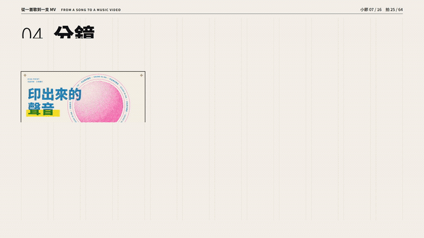
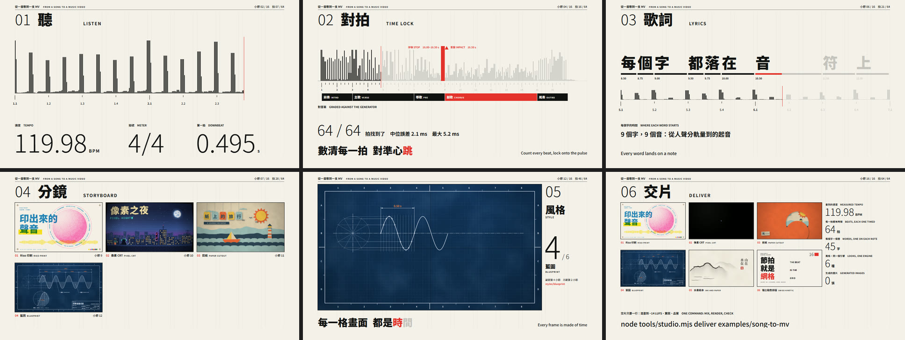
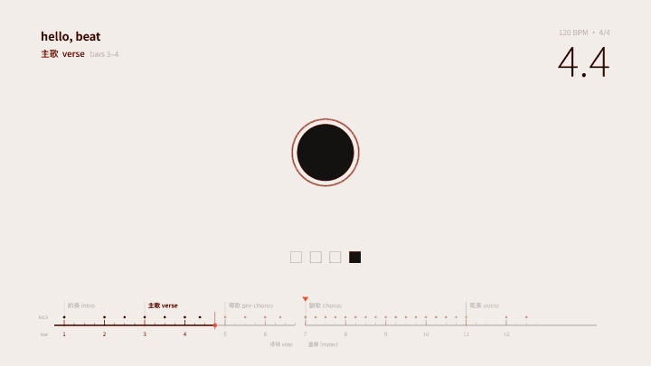
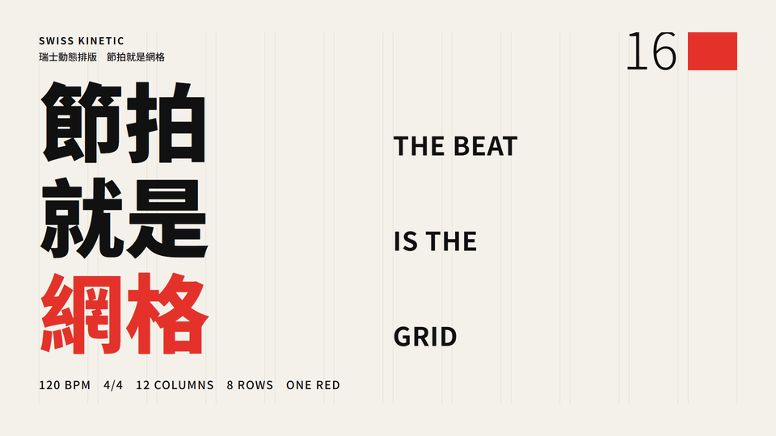
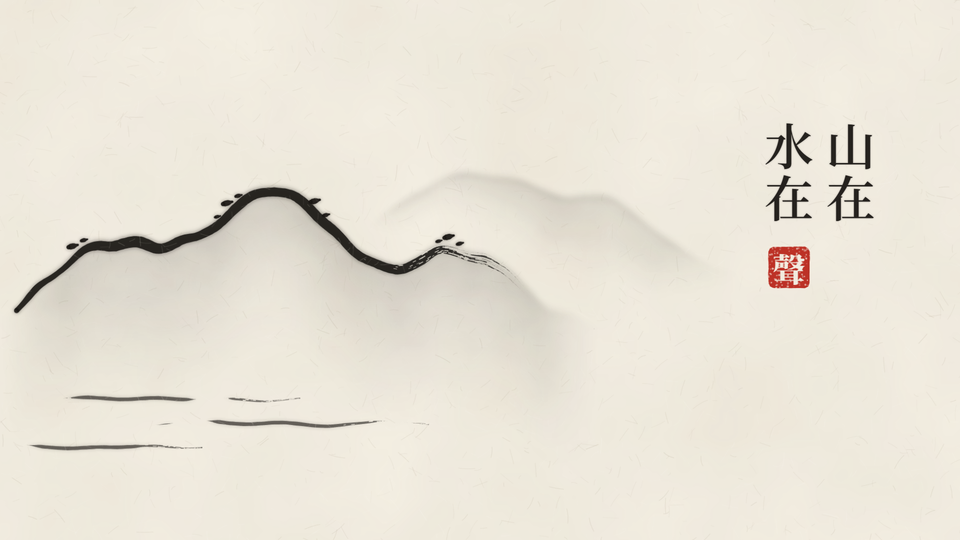
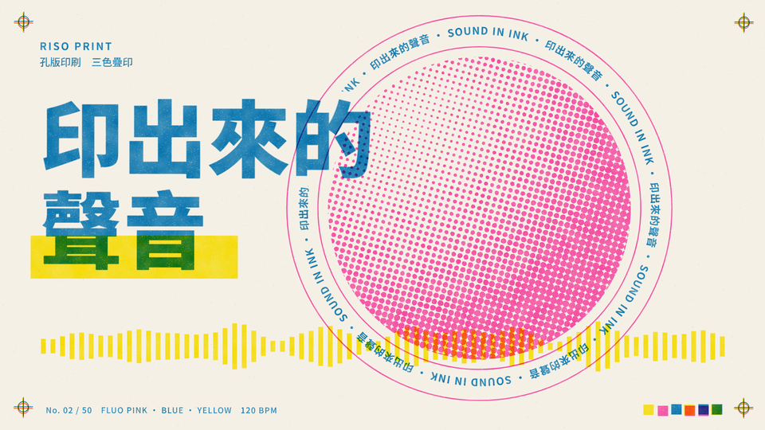
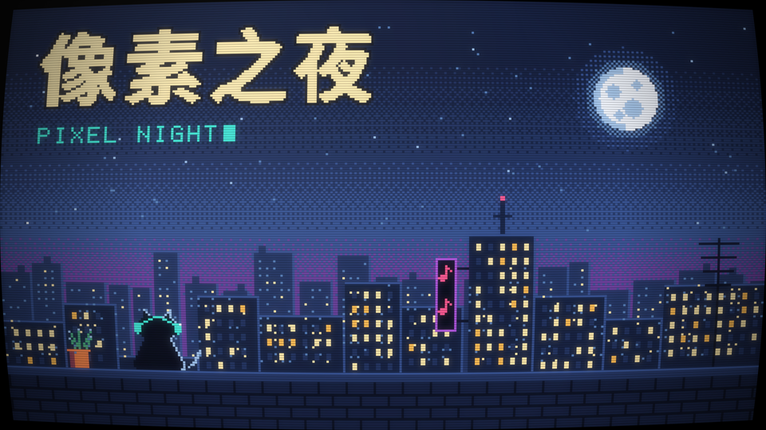
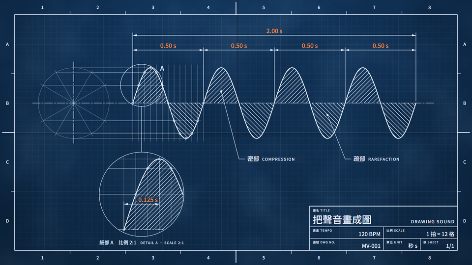

<div align="center">

# Claude Studio

**Music videos and animations with Claude Opus 5.5: the whole workflow, from a song to a film you can publish.**

[繁體中文](README.zh-TW.md) · [Quick start](#quick-start) · [Playbook](docs/en/PLAYBOOK.md) · [知識庫](docs/README.md) · [Examples](#examples) · [Style cards](styles/README.md)

</div>



<p align="center"><sub><a href="examples/song-to-mv/">From a song to a music video</a>: 35 seconds in six chapters, every frame drawn by code. The music, the lyrics and the pictures all come from this repository.</sub></p>

Opus 5.5 is not a video model. It makes films by **writing programs that draw every frame**. That
makes a film precise (a word lights up on the sung syllable), editable (fix one word and nothing
else moves), reproducible (the same moment always gives the same picture) and cumulative (code,
looks and checks carry over to the next film).

Claude Studio is everything that route needs, worked out from the films that did it best in the
month after Opus 5.5 shipped:

| | |
|---|---|
| **Knowledge base** | 18 chapters in Traditional Chinese and a condensed [English playbook](docs/en/PLAYBOOK.md): workflow, beat and lyric timing, storyboards, style, motion, sound, rendering, review, prompts, rights, cost, case studies, pitfalls, sources |
| **Claude Code plugin** | `mv-studio`: the [`studio` skill](skills/studio/SKILL.md) takes a film through eight gates; the [`studio-jury` agent](agents/studio-jury.md) reviews it with no production context |
| **Engine and tools** | A [deterministic canvas engine](engine/README.md) (a frame is a pure function of time, and every time comes from the song) and one command line: beat and section analysis, lyric timing, font subsetting, live preview, contact sheets, lint, a determinism check, sound effects and mixing to −14 LUFS, parallel GPU rendering, QA, one-command delivery. No npm dependencies |
| **Six style cards** | [Swiss Kinetic, Ink and Paper, Riso Print, Paper Cutout, Pixel CRT, Blueprint](styles/README.md): the rules that never change, each with an 8-second demo drawn in code |
| **Templates and prompts** | Three [project templates](templates/) (lyric MV, short, blank) and eight [prompt templates](prompts/README.md) in Chinese and English |
| **Two finished films** | [Every workflow document filled in](#examples), the QA reports, and how to rebuild each one |

## Quick start

You need **Node 22+**, **Python 3.10+** with numpy, scipy and Pillow, **ffmpeg**, and **Chrome or
Edge**. There is nothing to install with npm. Get the repository and check the machine:

```bash
git clone https://github.com/as52650610-max/claude-studio.git
cd claude-studio
node tools/studio.mjs doctor
```

Songs are not committed. Regenerate the flagship example's song (the same seed always makes the same
song), then open it in the live preview:

```bash
node tools/studio.mjs music examples/song-to-mv/audio/song.wav --plan-file examples/song-to-mv/music.json --seed 7 --truth examples/song-to-mv/data/song.truth.json --stems examples/song-to-mv/audio/stems
```

```bash
node tools/studio.mjs serve examples/song-to-mv
```

Open the address it prints. Space plays; ←/→ move a second, `,` `.` a frame, `[` `]` a bar; `D`
overlays the safe areas, bar and beat, the active shots and a flash on every beat; `L` loops the shot. To mix, render, check and package the film:

```bash
node tools/studio.mjs deliver examples/song-to-mv
```

### Make your own film with Claude Code

Load the plugin from your clone:

```bash
claude --plugin-dir .
```

Or, inside Claude Code, add the marketplace and install it:
`/plugin marketplace add as52650610-max/claude-studio` (or `./` from your clone), then
`/plugin install mv-studio@claude-studio`. Then say what to make:

```text
/mv-studio:studio Make a lyric video for my song (song.wav, lyrics in lyrics.txt). Stop at every gate so I can check.
```

The skill asks its questions once, then works gate by gate. It measures the beats and asks you to
listen to a click track, proposes three structures, storyboards on bars and beats, builds the hardest
10–15 seconds first, renders, checks its own work, and hands the film to an independent juror before
delivery. You keep the decisions that need a person: what the film says, whether the timing is right
by ear, and pressing publish.

## How a film is made

Eight gates. Each one ends in a file, so a new conversation picks up where the last one stopped.

| Gate | What comes out | Who decides |
|---|---|---|
| G0 Brief | `BRIEF.md`: goal, audience, platform, length, aspect, assets, budget, and whether it will be published (only then: the rights) | you, once |
| G1 Time lock | `songmap.json` with a click track to check by ear; lyrics aligned and proofread | your ears |
| G2 Treatment | `TREATMENT.md`: the agent's own ideas first, then three structures, one chosen; style frames; the look frozen | you choose |
| G3 Storyboard | `STORYBOARD.md`: each shot with its cue in bars and beats and an **Out** (how the next shot picks it up); key stills | you approve |
| G4 Sample | the hardest 10–15 seconds, with sound | you approve |
| G5 Build | chapter by chapter; `studio lint` clean; `studio verify` identical | the agent |
| G6 Review | automatic QA, an independent jury, your notes; fixes ranked P0–P2, one class per round | the agent and you |
| G7 Deliver | `studio deliver`: MP4, poster, subtitles, `DELIVERY.md`, QA report; plus `CREDITS.md` and `REPRODUCE.md` | you press publish |

The steps of each gate are in the [studio skill](skills/studio/SKILL.md); why each one exists, with the cases
it came from, is in [03 製作流程與關卡](docs/03-workflow.md) (summarised in [Playbook §4](docs/en/PLAYBOOK.md#4-the-workflow-eight-gates)).

## The engine

A film is a page that lists its shots. A shot is a function of the song: it never says a number of
seconds, so it stays on the music when the song, the tempo or the edit changes.

```js
// shots/chorus.js
export function chorus({ song }) {
  return {
    id: 'chorus',
    start: song.T(9),   // bar 9, from the analysed beats
    end: song.T(15),
    sfx: [{ t: song.T(9), sound: 'whoosh', sync: 'peak', why: 'the window opens on the impact', role: 'transition' }],
    draw(ctx, { t }) {
      const r = 120 * (1 + 0.2 * song.hit('kick', t, 0.09)); // swells on every analysed kick
      ctx.fillStyle = '#E4322B';
      ctx.beginPath();
      ctx.arc(960, 540, r, 0, 2 * Math.PI);
      ctx.fill();
    },
  };
}
```

`studio lint` finds clocks, unseeded randomness, network URLs and hard-coded times; `studio verify`
renders the same frames twice, in shuffled order, in a fresh browser, and compares the pixels. The
full API (song, lyrics, cues, easing, springs, text, grain, sound cues) is in
[engine/README.md](engine/README.md); every command is in
[references/commands.md](skills/studio/references/commands.md).

**Pictures from other tools.** A shot can also show frames made elsewhere: a Blender render, a
ComfyUI clip, footage filmed on green screen. `studio frames` brings them in and `studio timing`
hands the film's times to the other tool. Nothing is wrapped: each tool is used through its own
interface ([routes](skills/studio/SKILL.md#routes-what-draws-each-shot)).

## Examples

### [From a song to a music video](examples/song-to-mv/)



A music video that explains itself. Each chapter is one step of the workflow and one part of the
song, drawn from the data that step produced: the comb is the onset envelope the analyser heard, the
grading line compares its beats with the generator's answer key (64 of 64, median error 2.1 ms), and
each of the 45 sung characters lights up on its own measured vocal onset. The chorus plays the six style
cards' demos live, one a bar, on this song's beats. About 680 lines of shot code, no hard-coded
second, no generated image. [How to rebuild it](examples/song-to-mv/REPRODUCE.md), prompts included.

### [hello, beat](examples/hello-beat/)



The smallest complete film: one dot follows one song, and the screen shows what drives each motion.
27 seconds, four shots, three sounds, one file of code. Change the tempo in `music.json`, regenerate,
and the film follows without a code change.

Both examples have every document a film should have, filled in: `BRIEF`, `TREATMENT`,
`STORYBOARD`, `PROGRESS`, `REVIEW_LOG`, `CREDITS`, `REPRODUCE`. Compare them with your own.

## Style cards

| [](styles/swiss-kinetic/STYLE.md) | [](styles/ink-and-paper/STYLE.md) | [](styles/riso-print/STYLE.md) |
|---|---|---|
| **[Swiss Kinetic](styles/swiss-kinetic/STYLE.md)**: a 12-column grid, two weights, one red | **[Ink and Paper](styles/ink-and-paper/STYLE.md)**: a stroke on the beat, washes soaking out after it | **[Riso Print](styles/riso-print/STYLE.md)**: three spot inks, misregistered on every print |
| [](styles/paper-cutout/STYLE.md) | [](styles/pixel-crt/STYLE.md) | [](styles/blueprint/STYLE.md) |
| **[Paper Cutout](styles/paper-cutout/STYLE.md)**: hand-cut paper, moved by hand twelve times a second | **[Pixel CRT](styles/pixel-crt/STYLE.md)**: 320 × 180, 16 colours, on a tube that switches on and off | **[Blueprint](styles/blueprint/STYLE.md)**: construction lines, dimensions and a title block |

A card holds only what never changes: materials, colour, type, motion, camera, sound, native moves,
pitfalls. The story and the timings are directed afresh from your brief, because the first idea in
a style is its cliché. Cards are options, not a menu: at G2 the agent writes its own ideas before
it opens them, and option B is never an existing card.

## What the research found

The knowledge base was compiled from 2026-09-22, when Opus 5.5 shipped, to 2026-10-24. It draws on
89 Bilibili videos chosen by plays and favourites (the favourite rate is the most reliable signal of
quality), what their makers said in descriptions, replies and threads, the code and documents of
48 open repositories with their licences checked one by one, and Anthropic's documentation. Content
farms, prompt-hoarding accounts and "comment for the workflow" bait were left out. Every source is in
[docs/18-sources.md](docs/18-sources.md). Some of what it found:

- **One idea carries a film.** The most-played Opus MV was criticised for having too much in it and
  no centre; the most-favourited works can each be said in one sentence.
- **Storyboards need logic, and transitions are designed.** Beautiful frames joined by hard cuts read
  as a portfolio reel. So every shot here has an *Out*.
- **Time is measured, not guessed.** A beat tracker, a click track you listen to, the official
  lyrics aligned and proofread. When the tempo could be half or double, the tool says so.
- **References beat adjectives.** One creator reused the long brief behind a famous remake and added
  only a moodboard and an image model: a completely different film, about 20 million views. Viewers
  already recognise the default Opus look.
- **Iterate on evidence.** One 13,017-frame film rendered over 160,000 frames just for checking. Go
  from stills to a short sample to the full film, and let someone without the context score it.
- **Sound is the weakest link,** because the agent cannot hear. Every sound needs a reason and a
  landmark; loudness is measured; and somebody has to listen.

The ten principles, six technical routes (pure code, 3D, Blender, painterly, hybrid with generated
assets, frameworks) and 17 case studies are in the [playbook](docs/en/PLAYBOOK.md) and the [知識庫](docs/README.md).

## What's in the repository

| Folder | Contents |
|---|---|
| [`docs/`](docs/README.md) | The knowledge base: 18 chapters (zh-TW), the [English playbook](docs/en/PLAYBOOK.md), media |
| [`skills/studio/`](skills/studio/SKILL.md) | The `studio` skill: gates, rules, commands, craft notes |
| [`agents/`](agents/studio-jury.md) | `studio-jury`, the independent reviewer |
| [`engine/`](engine/README.md) | `studio.js` (the engine) and `player.js` (the live preview) |
| [`tools/`](tools/studio.mjs) | The `studio` command line, the renderer, and the Python analysers, lyric tools, sound effects, mixer, frame import and QA |
| [`styles/`](styles/README.md) | Six style cards with demos |
| [`templates/`](templates/) | Project templates used by `studio new` |
| [`prompts/`](prompts/README.md) | Prompt templates, zh-TW and English |
| [`examples/`](examples/) | `song-to-mv` and `hello-beat` |
| [`tests/`](tests/) | `npm test`: engine, command line, examples, and the Python self-tests |

## Honest limits

- **An agent cannot hear.** The tools measure loudness, peaks, sync and beat offsets; a person then
  listened to both example films and approved them. Your film needs the same: headphones, then a
  phone speaker, before you publish anything.
- The independent jury has not been run on the examples.
- Flash detection approximates WCAG 2.3.1. It is not a certified photosensitivity test.
- `studio music` writes practice music with known beats, for testing timing. It is not a score.
- Developed and tested on Windows 11 with Chrome and an RTX 3090 Ti. The tools look for browsers on
  macOS and Linux too, but have not been run there yet.
- The engine's contract may still change; each project keeps its own copy, so a finished film keeps
  rendering the same.

## Contributing

Bug reports, ideas and corrections are welcome as issues. Made a film with it? Share it in a
[showcase issue](../../issues/new?template=showcase.yml), with how you made it. If you wrote
something this project credits and want it corrected or removed, there is a template for that too.
Agents working on this repository read [AGENTS.md](AGENTS.md). Run `npm test` before a pull request.

## Licence and credits

[MIT](LICENSE). The code and text were written for this project; projects whose structure or ideas
were adapted under their licences, the CC BY 4.0 data, the algorithms and the fonts are credited in
[CREDITS.md](CREDITS.md). Fonts in the examples are subsets of Noto Sans TC and Noto Serif TC under the
SIL Open Font License, with the licence beside them.

This repository was researched, written and coded with Claude Opus 5.5 in Claude Code. Claude and
Opus are Anthropic's; this is a community project, not affiliated with or endorsed by Anthropic.

If Claude Studio helps you make something, a star helps other people find it.
